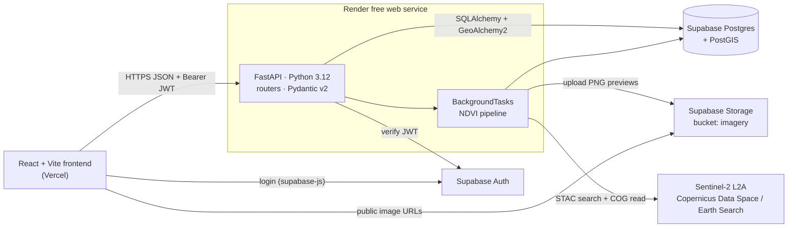
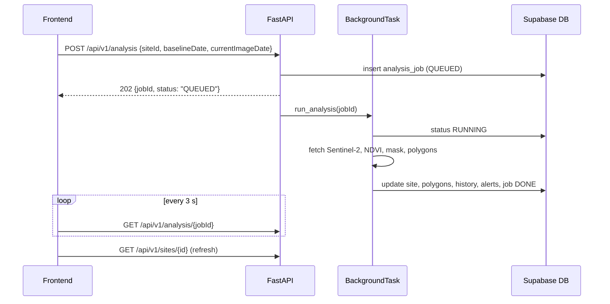

# AI-MINING — Backend PRD (TechExpo Student Edition)

> Simplified backend for [sarthforge/AI-MINING](https://github.com/sarthforge/AI-MINING): a React 19 + TypeScript + Vite dashboard for satellite-based illegal mining detection.
> **Stack:** FastAPI (Python 3.12) · Supabase free tier (Postgres + PostGIS, Auth, Storage) · Pydantic v2 · rasterio + numpy NDVI on Sentinel-2 · FastAPI BackgroundTasks · Vercel (frontend) + Render free (API).
> Owner: Sunil Maurya (backend) · Version 1.0 · 23 Oct 2026

---

## Table of contents

1. [Overview & problem](#1-overview--problem)
2. [Goals & non-goals](#2-goals--non-goals)
3. [Users](#3-users)
4. [Scope: MVP vs future](#4-scope-mvp-vs-future)
5. [Features mapped to frontend components](#5-features-mapped-to-frontend-components)
6. [Requirements](#6-requirements)
7. [Architecture](#7-architecture)
8. [Database schema](#8-database-schema)
9. [API endpoints](#9-api-endpoints)
10. [Folder structure](#10-folder-structure)
11. [Environment variables](#11-environment-variables)
12. [NDVI change-detection pipeline](#12-ndvi-change-detection-pipeline)
13. [Frontend integration](#13-frontend-integration)
14. [Git workflow](#14-git-workflow)
15. [4-week plan](#15-4-week-plan)
16. [Demo-day tips](#16-demo-day-tips)
17. [Risks & mitigations](#17-risks--mitigations)
18. [Success criteria (targets)](#18-success-criteria-targets)

---

## 1. Overview & problem

Illegal and out-of-licence mining (river gold dredging, quarries breaking their lease limits) destroys forest and pollutes rivers. Inspecting sites on foot is slow. Free Sentinel-2 satellite images (10 m pixels, a new pass every ~5 days) can show where vegetation has turned into bare ground.

**Today** the frontend runs entirely on hard-coded data in `src/data/mockData.ts` (sites, polygons, alerts, monthly history, telemetry) shaped by `src/types/index.ts`. Refreshing the page loses every change, and there is no real detection.

**This project** adds a small, free, deployable backend that:

- serves the same data from a real database, using the **exact same JSON shapes** as the TS types, so frontend changes stay tiny;
- saves alert dismissals;
- runs a real **NDVI before/after change detection** on Sentinel-2 for a chosen site and dates.

## 2. Goals & non-goals

**Goals**

- Replace every mock import with API calls (zero mock data in the demo build).
- Store sites, polygons, alerts and history in Supabase Postgres + PostGIS.
- Run NDVI change detection for at least one real site and show the result in the UI.
- Deploy publicly (Vercel + Render + Supabase) at zero cost.

**Non-goals (for TechExpo):** deep learning, real-time alerts, email/SMS notifications, multi-organisation accounts, mobile app.

## 3. Users

| User | What they need |
|---|---|
| **Admin (you / the team)** | Log in, run an analysis, dismiss or reset alerts, seed data. |
| **Viewer (judges, visitors, regulators, NGOs)** | Browse sites, polygons, charts and alerts without logging in; download a CSV. |
| **Analyst (future)** | Review detections and tune thresholds. Same as admin in the MVP. |

Roles are kept simple: `admin` and `viewer`, stored in a `profile` table linked to Supabase Auth.

## 4. Scope: MVP vs future

| MVP (TechExpo) | Future scope |
|---|---|
| Read APIs: sites, site detail, polygons, history, alerts, KPIs, telemetry | Celery + Redis job queue and cache |
| Dismiss / reset alerts saved in DB (admin) | U-Net (PyTorch) segmentation instead of NDVI thresholds |
| CSV export endpoint | Nightly scheduled scans of every site |
| Supabase Auth login, `admin` / `viewer` roles | Email / webhook notifications |
| NDVI change detection via `BackgroundTasks` + job status polling | Sentinel-1 radar for cloudy regions |
| PostGIS check: excavation area outside licence → alert | Upload licence shapefiles; PDF evidence reports |
| Seed script loading the current mock data | Analyst role, audit log, multi-tenant |

## 5. Features mapped to frontend components

| Component | What it shows | Backend feature / endpoint |
|---|---|---|
| `Header` / `Sidebar` | Site picker, date range, telemetry box | `GET /sites`, `GET /telemetry` |
| `KPICards` | Summary numbers | `GET /dashboard/kpis` (or computed client-side from sites + alerts) |
| `SatelliteViewer` | Current image + coloured SVG polygons | `GET /sites/{id}` → `polygons`, `currentImageUrl` (Supabase Storage) |
| `BeforeAfterSlider` | Baseline vs current image | `baselineImageUrl`, `currentImageUrl`, `baselineDate`, `lastObservationDate` |
| `ChangeTrackingChart` | Monthly excavation vs permitted cap, NDVI, turbidity | `GET /sites/{id}/history` (per site; mock has one global series) |
| `SiteDataTable` | All sites table | `GET /sites` with filters |
| `AnalysisModal` | Detailed site report + re-run | `GET /sites/{id}`, `POST /analysis`, `GET /analysis/{jobId}` |
| `AlertDrawer` | Alerts list, dismiss, reset | `GET /alerts`, `PATCH /alerts/{id}/dismiss`, `POST /alerts/reset` |
| `utils/csvExport.ts` | CSV download | `GET /export/sites.csv` (client export stays as fallback) |

## 6. Requirements

### Functional

| ID | Requirement |
|---|---|
| FR1 | List and fetch sites; each object matches `MiningSite` exactly, including `polygons`. |
| FR2 | Return per-site `MonthlyChangePoint[]` sorted by date. |
| FR3 | List alerts with `siteId`, `severity` and `dismissed` filters; responses match `SatelliteAlert`. |
| FR4 | Admin can dismiss one alert or reset all; the change persists. |
| FR5 | Return a KPI summary and the telemetry object (same keys as `SATELLITE_TELEMETRY`). |
| FR6 | Admin starts an analysis (site + two dates); it runs in the background; anyone can poll job status. |
| FR7 | The analysis computes NDVI before/after, change polygons, hectares and confidence, and updates the site, history and polygons. |
| FR8 | Detected area outside the licence polygon (PostGIS) creates an alert using the UI's categories and severities. |
| FR9 | Export sites as CSV. |
| FR10 | Write endpoints require a valid Supabase JWT with role `admin`. |

### Non-functional

- **Cost:** ₹0, free tiers only.
- **Performance (target):** read endpoints < 500 ms after the server has warmed up; analysis < 3 min for a small site.
- **Security:** Supabase `service_role` key only on the server (Render env), never in the frontend or Git; RLS enabled on all tables; CORS limited to `localhost:5173` and the Vercel URL.
- **Reliability:** failed jobs are saved as `FAILED` with a readable reason; `/health` endpoint.
- **Maintainability:** routers → services → models; Pydantic schemas separate from ORM models; auto docs at `/docs`; pytest for key endpoints and the NDVI maths.
- **Honesty:** results are labelled "suspected"; keep the frontend's disclaimer footer.

## 7. Architecture



**"Run analysis" flow**



> **BackgroundTasks limitation:** tasks run inside the web process. If Render restarts the server, a running job is lost and stays `RUNNING`. The fix is to mark old `RUNNING` jobs as `FAILED` on startup and re-run them. This is fine for a demo; Celery + Redis is the future upgrade.

## 8. Database schema

Run these in the Supabase SQL editor (or as `supabase/migrations/0001_init.sql`). JSON keys are camelCase and DB columns are snake_case; Pydantic handles the mapping. Enum values are the **exact strings** the UI uses. Tables are ordered so every foreign key target exists first, and no reserved words (`current_date`, `user`, `timestamp` as a type-like name) are used as column names. The TS field `timestamp` is stored as `detected_at` and aliased in the schema.

```sql
create extension if not exists postgis;

-- 1. profile (linked to Supabase Auth) — created BEFORE anything that references it
create table public.profile (
  id         uuid primary key references auth.users(id) on delete cascade,
  email      text unique not null,
  full_name  text,
  role       text not null default 'viewer' check (role in ('admin','viewer')),
  created_at timestamptz not null default now()
);

-- 2. mining_site  (MiningSite)
create table public.mining_site (
  id                    text primary key,                 -- 'site-01'
  code                  text unique not null,             -- 'AOI-04'
  name                  text not null,
  region                text not null,
  country               text not null,
  latitude              double precision not null,
  longitude             double precision not null,
  location              geography(Point,4326)
                        generated always as (st_setsrid(st_makepoint(longitude, latitude),4326)::geography) stored,
  formatted_coordinates text not null,
  total_area_ha         numeric(10,2) not null,
  new_excavation_ha     numeric(10,2) not null,
  change_percentage     numeric(6,2)  not null,
  confidence_score      numeric(5,2)  not null,
  concession_status     text not null check (concession_status in
                          ('Licensed','Unlicensed','Permit Expired','Boundary Breach')),
  alert_status          text not null check (alert_status in
                          ('High Priority','Investigation Required','Normal Compliance','Under Review')),
  mineral_target        text not null,
  last_observation_date date not null,
  baseline_date         date not null,
  ndvi_baseline         numeric(4,3) not null,
  ndvi_current          numeric(4,3) not null,
  sensor                text not null,
  resolution            text not null,
  notes                 text not null default '',
  current_image_url     text not null,
  baseline_image_url    text not null,
  updated_at            timestamptz not null default now()
);
create index idx_site_location on public.mining_site using gist(location);

-- 3. overlay_polygon  (OverlayPolygon)
create table public.overlay_polygon (
  id           text primary key,                          -- 'poly-unauthorized'
  site_id      text not null references public.mining_site(id) on delete cascade,
  title        text not null,
  poly_type    text not null check (poly_type in ('suspected','concession','pit','water','road')),
  area_ha      numeric(10,2) not null,
  color        text not null,                             -- 'rgba(239, 68, 68, 0.35)'
  stroke_color text not null,                             -- '#ef4444'
  label        text not null,
  points       text not null,                             -- SVG pixel points the viewer draws
  geom         geometry(Polygon,4326),                    -- real-world shape (nullable for mock rows)
  description  text not null default ''
);
create index idx_poly_site on public.overlay_polygon(site_id);
create index idx_poly_geom on public.overlay_polygon using gist(geom);

-- 4. satellite_alert  (SatelliteAlert) — references profile, so profile exists above
create table public.satellite_alert (
  id                text primary key,                     -- 'alt-001'
  site_id           text not null references public.mining_site(id) on delete cascade,
  title             text not null,
  description       text not null,
  severity          text not null check (severity in ('critical','warning','info','compliant')),
  detected_hectares numeric(10,2) not null,
  confidence        numeric(5,2) not null,
  detected_at       timestamptz not null,                 -- JSON "timestamp"
  coordinates       text not null,
  category          text not null check (category in ('Boundary Breach',
                      'Riparian Buffer Encroachment','Unregistered Pit Expansion','Tailings Plume')),
  dismissed         boolean not null default false,
  dismissed_by      uuid references public.profile(id),
  dismissed_at      timestamptz
);
-- siteName and region in the JSON come from a JOIN with mining_site
create index idx_alert_site   on public.satellite_alert(site_id);
create index idx_alert_active on public.satellite_alert(dismissed, severity, detected_at desc);

-- 5. monthly_change_point  (MonthlyChangePoint)
create table public.monthly_change_point (
  id                    bigint generated always as identity primary key,
  site_id               text not null references public.mining_site(id) on delete cascade,
  month_label           text not null,                    -- JSON "month": 'Jan 26'
  obs_date              date not null,                    -- JSON "date": '2026-01-15'
  permitted_cap_ha      numeric(10,2) not null,
  total_excavation_ha   numeric(10,2) not null,
  unauthorized_ha       numeric(10,2) not null,
  vegetation_index_ndvi numeric(4,3) not null,
  turbidity_index       numeric(6,2) not null,
  unique (site_id, obs_date)
);

-- 6. analysis_job
create table public.analysis_job (
  id                 uuid primary key default gen_random_uuid(),
  site_id            text not null references public.mining_site(id) on delete cascade,
  job_status         text not null default 'QUEUED' check (job_status in ('QUEUED','RUNNING','DONE','FAILED')),
  baseline_date      date not null,
  current_image_date date not null,                       -- not "current_date" (reserved)
  progress           int not null default 0,
  result_json        jsonb,
  error_message      text,
  created_by         uuid references public.profile(id),
  created_at         timestamptz not null default now(),
  finished_at        timestamptz
);

-- 7. telemetry_status (Sidebar SATELLITE_TELEMETRY, single row)
create table public.telemetry_status (
  id smallint primary key default 1 check (id = 1),
  constellation text, orbit_mode text, last_pass_utc text, next_pass_eta text,
  cloud_coverage text, sun_azimuth text, sensor_bands text,
  ground_sampling_distance text, cadastre_sync text
);

-- RLS: the API connects with the server-side DB URL; block direct public access from browsers
alter table public.profile              enable row level security;
alter table public.mining_site          enable row level security;
alter table public.overlay_polygon      enable row level security;
alter table public.satellite_alert      enable row level security;
alter table public.monthly_change_point enable row level security;
alter table public.analysis_job         enable row level security;
alter table public.telemetry_status     enable row level security;
create policy "own profile" on public.profile for select using (auth.uid() = id);
```

**Seed:** export the mock data once (`node scripts/export-mock.mjs > backend/app/seed/mock_data.json`, which is just `JSON.stringify` of the exports in `mockData.ts`), then run `python -m app.seed.seed`. It upserts every site, its polygon array, the alerts, the history series (assigned to `site-01`) and the telemetry row. To make yourself admin, sign up in Supabase Auth, then run `update profile set role='admin' where email='you@…';`.

## 9. API endpoints

Base URL: `https://<render-app>.onrender.com/api/v1` (local: `http://localhost:8000/api/v1`). JSON keys are camelCase. GET endpoints are public; write endpoints need `Authorization: Bearer <supabase access_token>` from an `admin`. Interactive docs are at `/docs`.

| Method | Path | Auth | Returns |
|---|---|---|---|
| GET | `/health` | public | `{"status":"ok","db":"ok"}` |
| GET | `/auth/me` | any logged-in user | `{"id","email","role"}` |
| GET | `/sites?country=&alertStatus=&q=` | public | `MiningSite[]` (with polygons) |
| GET | `/sites/{id}` | public | `MiningSite` |
| GET | `/sites/{id}/polygons` | public | `OverlayPolygon[]` |
| GET | `/sites/{id}/history?from=&to=` | public | `MonthlyChangePoint[]` |
| GET | `/alerts?siteId=&severity=&dismissed=` | public | `SatelliteAlert[]` |
| PATCH | `/alerts/{id}/dismiss` | admin | `SatelliteAlert` (`dismissed: true`) |
| POST | `/alerts/reset` | admin | `SatelliteAlert[]` (all un-dismissed) |
| GET | `/dashboard/kpis` | public | KPI object |
| GET | `/telemetry` | public | telemetry object |
| POST | `/analysis` | admin | `202` job object |
| GET | `/analysis/{jobId}` | public | job object |
| GET | `/export/sites.csv` | public | `text/csv` attachment |

Login is done in the frontend with `supabase.auth.signInWithPassword()`; the API only **verifies** the token.

**`GET /sites/site-01` → `MiningSite`**

```json
{
  "id": "site-01",
  "code": "AOI-04",
  "name": "Rio Tapajós River Basin — Sector 7",
  "region": "Pará State",
  "country": "Brazil",
  "latitude": -4.3056,
  "longitude": -53.7364,
  "formattedCoordinates": "04°18'20\" S, 53°44'11\" W",
  "totalAreaHa": 18.6,
  "newExcavationHa": 2.4,
  "changePercentage": 24.8,
  "confidenceScore": 94.2,
  "concessionStatus": "Boundary Breach",
  "alertStatus": "High Priority",
  "mineralTarget": "Alluvial Gold & Aggregate",
  "lastObservationDate": "2026-09-28",
  "baselineDate": "2025-11-14",
  "ndviBaseline": 0.78,
  "ndviCurrent": 0.29,
  "sensor": "Sentinel-2 MSI + WorldView-3 Opt/SAR",
  "resolution": "0.3m Resampled (Demo)",
  "notes": "Excavation expanded past northern permitted cadastre into riparian river buffer.",
  "currentImageUrl": "/satellite_current.jpg",
  "baselineImageUrl": "/satellite_baseline.jpg",
  "polygons": [
    {
      "id": "poly-unauthorized",
      "title": "Zone Alpha: Suspected Unauthorized Excavation",
      "type": "suspected",
      "areaHa": 2.4,
      "color": "rgba(239, 68, 68, 0.35)",
      "strokeColor": "#ef4444",
      "label": "ALERT: 2.4 ha Suspected Breach (94.2%)",
      "points": "200,320 320,290 440,310 490,400 420,530 330,550 220,500 170,410",
      "description": "Active heavy earthmoving benches identified beyond the northern licensed cadastre boundary. Permit verification required."
    }
  ]
}
```

**`GET /alerts` → `SatelliteAlert[]`**

```json
[
  {
    "id": "alt-001",
    "siteId": "site-01",
    "siteName": "Rio Tapajós River Basin — Sector 7",
    "region": "Pará State",
    "title": "Boundary breach detected",
    "description": "Excavation detected outside the licensed cadastre.",
    "severity": "critical",
    "detectedHectares": 2.4,
    "confidence": 94.2,
    "timestamp": "2026-09-28T14:22:04Z",
    "coordinates": "04°18'20\" S, 53°44'11\" W",
    "category": "Boundary Breach",
    "dismissed": false
  }
]
```

**`GET /sites/site-01/history` → `MonthlyChangePoint[]`**

```json
[
  { "month": "Jan 26", "date": "2026-01-15", "permittedCapHa": 16.0, "totalExcavationHa": 14.8,
    "unauthorizedHa": 0.0, "vegetationIndexNDVI": 0.74, "turbidityIndex": 12 },
  { "month": "Feb 26", "date": "2026-02-15", "permittedCapHa": 16.0, "totalExcavationHa": 15.1,
    "unauthorizedHa": 0.1, "vegetationIndexNDVI": 0.71, "turbidityIndex": 15 }
]
```

**`GET /dashboard/kpis`** (values illustrative, computed live)

```json
{ "totalSites": 12, "activeAlerts": 3, "criticalAlerts": 2, "totalNewExcavationHa": 9.3,
  "averageConfidence": 91.5, "boundaryBreaches": 2, "averageNdviDrop": 0.31 }
```

**`GET /telemetry`**

```json
{ "constellation": "Copernicus Sentinel-2 & WorldView-3 Sync", "orbitMode": "Sun-synchronous, 786 km Altitude",
  "lastPassUTC": "2026-09-28 14:22:04", "nextPassETA": "2h 41m (Sentinel-2B Pass #48)",
  "cloudCoverage": "4.2% (Clear Optical Quality)", "sunAzimuth": "128.4°",
  "sensorBands": "B02 (Blue), B03 (Green), B04 (Red), B08 (NIR), B11 (SWIR)",
  "groundSamplingDistance": "10m Native / 0.3m Sharpened", "cadastreSync": "ANM Federal Database 2026 Q3 (Verified)" }
```

**`POST /analysis`** (admin)

```jsonc
// request
{ "siteId": "site-01", "baselineDate": "2025-11-14", "currentImageDate": "2026-09-28" }
// 202 response, and the same shape from GET /analysis/{jobId}
{ "jobId": "8f1c2e4a-…", "siteId": "site-01", "status": "RUNNING", "progress": 60,
  "error": null, "result": null }
```

When `status` is `"DONE"`, `result` holds the updated `MiningSite`.

**Error shape (all errors)**

```json
{ "status": 404, "error": "NOT_FOUND", "message": "Site site-99 not found", "path": "/api/v1/sites/site-99" }
```

Codes: 200, 202, 400 (validation), 401 (missing or expired token), 403 (not admin), 404, 409 (job already running for this site), 500.

### Key code (Pydantic v2 camelCase)

```python
from typing import Literal
from datetime import date, datetime
from pydantic import BaseModel, ConfigDict, Field
from pydantic.alias_generators import to_camel

class CamelModel(BaseModel):
    model_config = ConfigDict(alias_generator=to_camel, populate_by_name=True, from_attributes=True)

class OverlayPolygonOut(CamelModel):
    id: str; title: str
    type: Literal["suspected", "concession", "pit", "water", "road"] = Field(validation_alias="poly_type")
    area_ha: float; color: str; stroke_color: str; label: str; points: str; description: str

class SatelliteAlertOut(CamelModel):
    id: str; site_id: str; site_name: str; region: str; title: str; description: str
    severity: Literal["critical", "warning", "info", "compliant"]
    detected_hectares: float; confidence: float
    timestamp: datetime = Field(validation_alias="detected_at")
    coordinates: str
    category: Literal["Boundary Breach", "Riparian Buffer Encroachment",
                      "Unregistered Pit Expansion", "Tailings Plume"]
    dismissed: bool

class MonthlyChangePointOut(CamelModel):
    month: str = Field(validation_alias="month_label")
    date: date = Field(validation_alias="obs_date")
    permitted_cap_ha: float; total_excavation_ha: float; unauthorized_ha: float
    vegetation_index_ndvi: float = Field(alias="vegetationIndexNDVI")  # to_camel would give ...Ndvi
    turbidity_index: float
```

`MiningSiteOut` follows the same pattern, with every field from `MiningSite` and `polygons: list[OverlayPolygonOut] | None`. FastAPI serialises responses by alias, so the JSON comes out camelCase.

```python
# app/core/auth.py — verify the Supabase JWT, then check the role in profile
def current_user(cred=Depends(HTTPBearer()), db=Depends(get_db)) -> Profile:
    try:
        claims = jwt.decode(cred.credentials, settings.supabase_jwt_secret,
                            algorithms=["HS256"], audience="authenticated")
    except JWTError:
        raise HTTPException(401, "Invalid or expired token")
    profile = db.get(Profile, claims["sub"])
    if not profile: raise HTTPException(401, "No profile")
    return profile

def require_admin(user: Profile = Depends(current_user)) -> Profile:
    if user.role != "admin": raise HTTPException(403, "Admin only")
    return user
```

If your Supabase project uses the newer asymmetric JWT signing keys, verify against the project's JWKS URL (`https://<ref>.supabase.co/auth/v1/.well-known/jwks.json`) instead of the shared secret.

## 10. Folder structure

```text
AI-MINING/
├── src/                      # frontend (friend) — unchanged except src/api/*
├── backend/
│   ├── pyproject.toml        # Python 3.12, uv or pip
│   ├── requirements.txt      # for Render
│   ├── .env.example
│   ├── app/
│   │   ├── main.py           # FastAPI app, CORS, routers, error handlers, startup cleanup
│   │   ├── core/             # config.py (pydantic-settings), auth.py, errors.py
│   │   ├── db/               # session.py (engine, get_db)
│   │   ├── models/           # SQLAlchemy + GeoAlchemy2: site, polygon, alert, history, job, profile, telemetry
│   │   ├── schemas/          # Pydantic v2 camelCase: site, alert, history, kpi, job
│   │   ├── routers/          # sites, alerts, dashboard, analysis, export, auth
│   │   ├── services/         # site_service, alert_service, alert_rules, kpi, storage (Supabase Storage)
│   │   ├── ml/               # stac.py, ndvi.py, change.py, vectorize.py, preview.py
│   │   └── seed/             # mock_data.json, seed.py
│   ├── supabase/migrations/  # 0001_init.sql (or alembic/ if you prefer)
│   ├── notebooks/            # ndvi_explore.ipynb
│   └── tests/                # test_sites.py, test_alerts.py, test_ndvi.py
└── scripts/export-mock.mjs
```

Main dependencies: `fastapi`, `uvicorn[standard]`, `sqlalchemy>=2`, `geoalchemy2`, `shapely`, `psycopg[binary]`, `pydantic>=2`, `pydantic-settings`, `python-jose[cryptography]`, `supabase` (Storage uploads), `rasterio`, `numpy`, `pystac-client`, `httpx`. Dev: `pytest`, `ruff`. Alembic is optional; plain SQL migrations in Supabase are simpler.

## 11. Environment variables

`backend/.env.example` (commit this file; never commit `.env`):

```dotenv
# Supabase Postgres — use the pooler connection string (port 6543) from Project Settings → Database
DATABASE_URL=postgresql+psycopg://postgres.<ref>:<password>@aws-0-<region>.pooler.supabase.com:6543/postgres
SUPABASE_URL=https://<ref>.supabase.co
# Server-only secret: used for Storage uploads. NEVER put this in the frontend, Vercel or Git.
SUPABASE_SERVICE_ROLE_KEY=
# Used to verify user access tokens (Project Settings → API → JWT secret)
SUPABASE_JWT_SECRET=
STORAGE_BUCKET=imagery
CORS_ORIGINS=http://localhost:5173,https://<your-app>.vercel.app
NDVI_DROP_THRESHOLD=0.3
MAX_CLOUD_PCT=20
STAC_URL=https://earth-search.aws.element84.com/v1
```

Frontend `.env` (Vercel): only `VITE_API_URL`, `VITE_SUPABASE_URL` and `VITE_SUPABASE_ANON_KEY`. The anon key is designed to be public; the **service_role key must never appear in any `VITE_` variable**, because Vite bundles those into the browser JavaScript.

## 12. NDVI change-detection pipeline

1. **Trigger:** `POST /analysis` saves an `analysis_job` (`QUEUED`) and adds `run_analysis(job_id)` to `BackgroundTasks`. Allow one running job per site (409 otherwise).
2. **Area of interest:** build a bounding box around the site (from the concession polygon `geom` if set, otherwise about ±1 km around lat/lon).
3. **Find scenes:** `pystac-client` searches the `sentinel-2-l2a` collection (Earth Search, or Copernicus Data Space STAC) for each date ± 15 days, with `eo:cloud_cover < MAX_CLOUD_PCT`, and picks the least cloudy scene.
4. **Read only what's needed:** `rasterio` reads windows of the Cloud-Optimised GeoTIFFs for B04 (red), B08 (NIR) and SCL (scene classification), so it doesn't download whole tiles.
5. **Cloud mask:** drop SCL classes 3, 8, 9 and 10 (shadow, cloud, cirrus). If more than 40% of the area is masked, mark the job `FAILED` with "too cloudy, try other dates".
6. **NDVI:** `ndvi = (B08 - B04) / (B08 + B04)` as float32 with numpy, for both dates.
7. **Change mask:** `drop = ndvi_baseline - ndvi_current`; flag a pixel when `drop > NDVI_DROP_THRESHOLD` (start at 0.3) **and** `ndvi_current < 0.2` (now bare). Remove tiny blobs (fewer than ~5 pixels).
8. **Polygons and area:** `rasterio.features.shapes` + shapely give polygons in lat/lon. Each 10 m pixel is 0.01 ha. Confidence is a simple score from the mean NDVI drop and blob size, clearly labelled as heuristic.
9. **Licence check (PostGIS):** `ST_Area(ST_Difference(detected, concession)::geography)/10000` gives the hectares outside the licence. If that is above 0.1 ha, create a `Boundary Breach` alert (`critical`); if the detection meets a `water` polygon, create a `Riparian Buffer Encroachment` alert (`warning`).
10. **Images:** render true-colour PNG previews (B04/B03/B02, contrast-stretched) for both dates, upload them to Supabase Storage, and set `baselineImageUrl` / `currentImageUrl` to the public URLs. Convert polygons to SVG `points` in the preview's pixel space.
11. **Save:** update the site's `ndviBaseline`, `ndviCurrent`, `newExcavationHa`, `changePercentage`, `confidenceScore` and `lastObservationDate`, insert polygons and a `monthly_change_point`, and set the job to `DONE` (or `FAILED` with `error_message`).
12. **Future:** a U-Net (PyTorch) model trained on labelled mine pits replaces step 7 behind the same function signature; Celery + Redis replace BackgroundTasks.

```python
def ndvi(red, nir):
    red, nir = red.astype("float32"), nir.astype("float32")
    with np.errstate(divide="ignore", invalid="ignore"):
        return np.where((nir + red) == 0, np.nan, (nir - red) / (nir + red))
```

## 13. Frontend integration

| File | Mock import today | Replace with |
|---|---|---|
| `src/App.tsx` | `MONITORED_SITES` | `GET /sites` in `useEffect`; select the first site |
| `src/App.tsx` | `SIMULATED_ALERTS` + local dismiss/reset | `GET /alerts`, `PATCH /alerts/{id}/dismiss`, `POST /alerts/reset` |
| `src/components/ChangeTrackingChart.tsx` | `HISTORICAL_CHANGE_DATA` | `GET /sites/{selectedSite.id}/history` |
| `src/components/SatelliteViewer.tsx` | `OVERLAY_POLYGONS` fallback | `site.polygons` from the API (fallback `[]`) |
| `src/components/Sidebar.tsx` | `SATELLITE_TELEMETRY` | `GET /telemetry` |
| `src/components/AnalysisModal.tsx` | static report | add a "Run analysis" button → `POST /analysis`, then poll `GET /analysis/{jobId}` |
| `src/utils/csvExport.ts` | client-side CSV | optional link to `GET /export/sites.csv` |
| new `src/api/client.ts` | — | `fetch` wrapper adding `VITE_API_URL` and the Supabase access token |

```ts
// src/api/client.ts
const BASE = import.meta.env.VITE_API_URL ?? "http://localhost:8000/api/v1";
export async function api<T>(path: string, init: RequestInit = {}, token?: string): Promise<T> {
  const res = await fetch(BASE + path, {
    ...init,
    headers: { "Content-Type": "application/json",
               ...(token ? { Authorization: `Bearer ${token}` } : {}), ...init.headers },
  });
  if (!res.ok) throw new Error((await res.json()).message ?? res.statusText);
  return res.json() as Promise<T>;
}
```

Add loading and error states, and keep `mockData.ts` only as an offline fallback for the demo.

## 14. Git workflow

1. Your friend adds you as a **collaborator** (Settings → Collaborators).
2. Keep all backend code in `backend/`. Only touch `src/` for the integration work, and agree on it first.
3. One short-lived branch per feature, merged by Pull Request with your friend reviewing:

   ```bash
   git checkout main && git pull
   git checkout -b feat/alerts-api
   # code + tests
   git add backend && git commit -m "feat(alerts): list, dismiss, reset"
   git push -u origin feat/alerts-api   # open PR → review → squash merge
   ```

4. Commit `docs/api.md` or link `/docs` early so the frontend can build against the contract.
5. Add GitHub Actions to run `ruff` and `pytest` on every PR.
6. `.gitignore`: `.env`, `__pycache__/`, `*.tif`, `notebooks/data/`.

## 15. 4-week plan

| Week | Work | Done when |
|---|---|---|
| **1 — Setup + MVP API** | Supabase project, PostGIS on, run `0001_init.sql`; FastAPI skeleton, config, CORS, `/health`; models + schemas; seed from mock data; `GET /sites`, `/sites/{id}`, `/history`, `/polygons`, `/telemetry`. Deploy to Render. | The frontend on :5173 shows the same screens from the API. |
| **2 — Alerts, auth, integration** | `GET /alerts`, dismiss/reset, KPIs, CSV export; Supabase Auth login in the frontend; `require_admin`; error handler; pytest; help swap all mock imports; deploy the frontend to Vercel. | Zero mock imports; dismiss survives refresh; the Vercel site works end-to-end. |
| **3 — NDVI pipeline** | Notebook first: STAC search, cloud mask, NDVI, change mask, polygons for one real site. Then `app/ml`, `POST /analysis` + BackgroundTasks + job polling, Storage previews, PostGIS licence check → alerts. | "Run analysis" updates images, polygons, chart and alerts for one real site. |
| **4 — Polish + demo** | Tune the threshold on 2–3 sites, precompute results, README with screenshots and architecture, demo script, slides, rehearse, fix bugs. | A smooth 3-minute demo, with backups ready. |

## 16. Demo-day tips

- **Precompute results:** run the analyses beforehand and store them. During the demo, show the saved results, and run a live analysis only on a small, known-good site.
- **Wake everything up:** free Supabase projects **pause after about 7 days of no activity**, so open the dashboard and run a query the day before. Render free services **sleep after about 15 minutes idle** and take up to a minute to wake, so hit `/health` 5 minutes before you present, or ping it every 10 minutes with a free uptime checker during the expo.
- **Offline backup:** a screen recording of the full flow, screenshots in the slides, and a build that falls back to `mockData.ts` if the API fails.
- **Story in 3 minutes:** problem → map with a red breach polygon → before/after slider → NDVI chart → alert → "Run analysis" → architecture slide.
- **Explain honestly:** "NDVI drop + bare-soil threshold on 10 m Sentinel-2; results are suspected, not proof; U-Net is next."
- Use a fresh browser profile, a stable hotspot, and an admin account already logged in.

## 17. Risks & mitigations

| Risk | Impact | Mitigation |
|---|---|---|
| Clouds over tropical sites | No usable image | Wider date window, cloud filter, pick dry-season dates, precompute |
| Render cold start / restarts | Slow first request; lost background jobs | Warm-up ping; mark stale `RUNNING` jobs `FAILED` on startup; precomputed results |
| Supabase pauses when inactive | API errors on demo day | Use it daily; check the day before |
| Free-tier memory (512 MB on Render) | rasterio crashes on big areas | Small bounding boxes, windowed reads, float32, one job at a time |
| Leaked service_role key | Full database access by anyone | Server env only, never `VITE_`, rotate if exposed, RLS on |
| NDVI false positives (harvest, seasons, floods) | Wrong alerts | Bare-soil check, same-season dates, "suspected" wording, admin dismiss |
| TS ↔ API mismatch | Frontend breaks | Pydantic `Literal` types and a pytest that checks the JSON keys against the TS fields |
| Scope creep | Not finished in time | MVP first; Celery, Redis and U-Net stay in the future list |

## 18. Success criteria (targets)

These are **targets** to measure, not results yet.

| Metric | Target |
|---|---|
| Mock imports left in the demo build | 0 |
| Endpoints whose JSON matches the TS types (pytest) | 100% |
| Real sites analysed with NDVI end-to-end | ≥ 3 |
| Detected-area agreement with a hand-drawn reference polygon on test sites | within ±30% |
| Analysis time for a ~2 km² area | < 3 min |
| Warm read latency (p95) | < 500 ms |
| Demo run-through without errors | 3 rehearsals in a row |
| Hosting cost | ₹0 |
